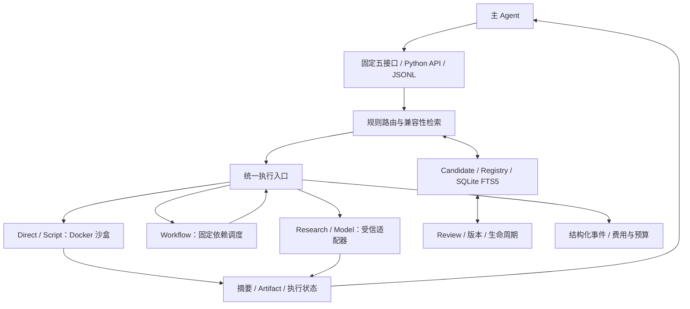
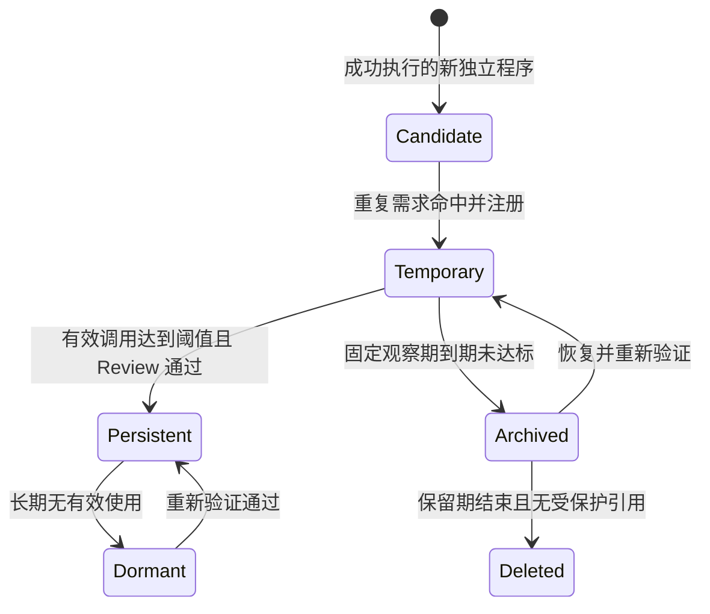

# ATR — Adaptive Tool Runtime

**让 Coding / Research Agent 将重复使用的独立程序，逐步沉淀为可检索、可验证、可管理的工具。**

ATR 是一个面向单用户 Agent 的 Python 运行时，提供命令执行、程序捕获、工具复用、生命周期管理及成本记录。主 Agent 负责理解任务和生成程序，ATR 负责执行与管理。无论工具库如何增长，模型侧始终使用固定五接口。

技术栈：**Python 3.12+ · SQLite WAL / FTS5 · Docker · Pydantic · JSON Schema**。

## 适合什么场景

- **Coding**：复用异常分析、日志处理、数据转换等独立程序，并记录其执行和验证结果。
- **Research**：把检索、证据获取和模型处理组织成带来源记录的流程，更新资料时重新获取证据。
- **Agent 集成**：通过 Python API 或 JSONL 协议，把工具执行与管理接到现有 Agent 中。

普通命令直接执行；新生成且成功执行的独立程序可以保存为 Candidate；重复需求命中候选后，系统注册工具、运行契约用例并尝试复用。项目业务源码修改默认作为任务产物处理。

## 核心能力

| 能力 | 实现内容 |
|---|---|
| 固定五接口 | `read`、`execute`、`tool_create`、`tool_review`、`tool_delete` |
| 受控执行 | Docker 默认隔离、权限声明、环境检查、资源约束、取消和运行查询 |
| 检索与捕获 | 精确匹配、FTS5、作用域和输入输出兼容性过滤、独立程序托管副本 |
| 生命周期 | Candidate → Temporary → Persistent，以及归档、休眠、复检和清理 |
| 版本与依赖 | 不可变版本、固定依赖、引用保护、Review 和原子版本回滚 |
| 工作流 | 多步骤工具组合，支持输入和前序步骤结果引用 |
| Research / 模型 | HTTPS 主机白名单、来源和时间记录、命名模型与凭证适配器 |
| 可观测性 | 任务与运行事件、输出 Artifact、脱敏、Token 和货币费用分别报告 |
| 预算 | 调用前预留费用上界，缺失账单保留预算，实际凭证结算去重 |

## 架构



控制数据库、策略和凭证由宿主控制层管理；动态程序在单独执行环境中运行。完整设计见 [实施计划](docs/plan.md)，详细执行约束见 [运行说明](docs/runtime.md)。

## 快速开始

需要 Python 3.12+、[uv](https://docs.astral.sh/uv/) 和支持 Linux 容器的 Docker 引擎。以下命令从仓库根目录执行。

### 1. 获取代码并准备环境

```bash
git clone https://github.com/wblxr408/ATR_Agent_Adaptive_Tool_System.git
cd ATR_Agent_Adaptive_Tool_System
uv sync --python 3.12
docker build -f Dockerfile.sandbox -t atr-sandbox:0.1 .
```

示例使用 `examples/workspace` 作为工具工作区，`examples/operator.example.json` 作为操作者配置。两者分离，配置中已统一设置 `project_key=repo:demo`。示例不需要模型 API Key。

### 2. 运行命令，观察候选并复用

**PowerShell：**

```powershell
$atrArgs = @('--workspace', 'examples/workspace', '--config', 'examples/operator.example.json')

uv run atr @atrArgs init
uv run atr @atrArgs execute examples/direct.json
uv run atr @atrArgs execute examples/observe.json
uv run atr @atrArgs execute examples/observe-repeat.json
uv run atr @atrArgs execute examples/tool.execute.json
uv run atr @atrArgs search sum
uv run atr @atrArgs tools
```

**Bash / Zsh：**

```bash
atr_args=(--workspace examples/workspace --config examples/operator.example.json)

uv run atr "${atr_args[@]}" init
uv run atr "${atr_args[@]}" execute examples/direct.json
uv run atr "${atr_args[@]}" execute examples/observe.json
uv run atr "${atr_args[@]}" execute examples/observe-repeat.json
uv run atr "${atr_args[@]}" execute examples/tool.execute.json
uv run atr "${atr_args[@]}" search sum
uv run atr "${atr_args[@]}" tools
```

这组示例依次演示：

1. `direct.json`：读取示例工作区的数据求和，结果为 `7`，不捕获候选。
2. `observe.json`：执行新独立程序，结果为 `7`，保存 Candidate。
3. `observe-repeat.json`：在另一根任务中使用相同程序，结果为 `18`，触发候选注册、Review 和工具复用。
4. `tool.execute.json`：通过固定 `tool_id=project.sum` 调用已注册工具，结果为 `18`。

执行结果包含 `run_id`、状态、输出片段和 Artifact 引用。对有副作用的业务操作，应保持稳定的 `root_task_id` 和 `operation_id`；同一标识的重复请求返回已有运行。

### 3. 创建并运行复合工具

沿用上面的 PowerShell 参数：

```powershell
uv run atr @atrArgs create examples/workflow.create.json
uv run atr @atrArgs review project.numeric-analysis
uv run atr @atrArgs execute examples/workflow.execute.json
```

Bash / Zsh 中将 `@atrArgs` 替换为 `"${atr_args[@]}"`。复合工具固定依赖 `project.sum@v1`，输出为：

```json
{"first_total":{"sum":5},"second_total":{"sum":6}}
```

步骤参数支持 `{"$input":"first"}` 和 `{"$step":"previous_step.result"}`。上层工具必须声明子工具需要的权限和副作用。

## Agent 接入

### JSONL 协议

```powershell
uv run atr definitions
uv run atr @atrArgs serve
```

`serve` 每行接收一个 JSON 对象，每行返回一个带请求 ID 的响应。完整接口定义见 [interfaces.json](atr/schemas/interfaces.json)。例如检索一个兼容工具：

```json
{"id":"lookup-1","name":"read","arguments":{"operation":"registry_search","arguments":{"query":"sum","inputs":{"numbers":[1,2]}}}}
```

调用已注册工具：

```json
{"id":"run-1","name":"execute","arguments":{"root_task_id":"agent-task-1","mode":"tool","tool_id":"project.sum","inputs":{"numbers":[1,2]}}}
```

后台执行设置 `background=true`，并保持 `serve` 进程运行；随后用 `read(operation=run)` 查询状态，用 `execute(action=cancel)` 取消。

### Python API

```python
from pathlib import Path

from atr.service import Runtime

with Runtime(workspace=Path("examples/workspace"), project_key="repo:demo") as runtime:
    result = runtime.execute({
        "root_task_id": "task-1",
        "argv": ["rg", "numbers", "input.json"],
        "permissions": {"file_read": ["workspace"]},
    })
    print(result.model_dump(mode="json"))
```

## 生命周期与版本



默认参数均可配置：候选保留14天，临时观察期14天；至少5次有效调用、覆盖2个根任务，或满足同任务10个不同输入的例外，才能晋升。失败、重试、缓存和重复记账不计入晋升。归档保留30天，持久工具90天闲置后休眠。

新版本通过 `tool_create(base_version=...)` 提出，通过 Review 后才能切换。运行中发现输出契约失败会隔离该版，并选择可用旧版；当前失败操作不会自动重放。操作者也可以显式回滚：

```powershell
uv run atr @atrArgs review project.sum --action rollback --version v1
```

## Research、费用和管理

[Research 创建示例](examples/research.create.json) 演示带来源和时间的 HTTPS 文档获取。当前示例配置只允许 `www.sqlite.org`。模型适配器的 Endpoint、模型、凭证环境变量和预算由操作者配置，详见 [适配器配置](docs/runtime.md#research-和模型适配器)。

费用报告区分输入/输出/缓存 Token、已知金额、估计金额、未知费用和待结算预算。宿主 Agent 的模型费用可通过 `record-cost` 提交；实际供应商凭证通过 `settle-cost` 结算。

| 命令 | 用途 |
|---|---|
| `status` / `tools` / `runs` | 查看运行时、工具和运行记录 |
| `search QUERY` | 检索工具和候选 |
| `read OPERATION ARGS.json` | 读取工作区片段、源码、Manifest 或 Artifact |
| `cost --task TASK_ID` / `metrics` | 查看任务费用与聚合指标 |
| `events --export events.jsonl` | 导出脱敏事件 |
| `cancel RUN_ID` | 请求取消运行及其子运行 |
| `maintenance` | 执行一次到期、晋升和清理维护 |
| `clear-candidates` | 清空候选池 |
| `disable` | 暂停创建、关闭动态执行并取消动态运行 |
| `switch auto_create on` / `switch dynamic_execute on` | 分别恢复创建或动态执行 |

## 项目结构

```text
atr/
  agent_adapter.py      # 固定五接口和协议封装
  service.py            # 统一调度、Review、取消及管理入口
  router.py             # 规则检索与可选模型路由
  control/              # Registry、依赖、生命周期
  runtime/              # Docker 沙盒与持久取消通知
  adapters.py           # Research / 模型代理
  accounting.py         # 费用、预算预留与结算
  models.py             # 数据契约
  storage.py            # SQLite 与内容寻址对象
  schemas/              # 可分发 JSON Schema
  evals.py              # 观察记录与配对报告接口
  cli.py                # 命令行
examples/               # Direct、Candidate、Tool、Workflow、Research 请求
tests/                  # 功能契约与可选 Docker 边界用例
docs/                   # 设计、运行说明与实施记录
openspec/               # 规格和实施任务
```

## 开发与验证

开发工具随 `uv sync` 安装。可分别运行以下检查；应根据当前改动选择需要的检查范围。

```powershell
uv run ruff check atr tests scripts
uv run mypy atr
uv run python scripts/export_schemas.py
uv build
```

初版实现的验证记录为 **42 个功能用例通过**，Ruff、mypy、Schema 生成和打包通过，详见 [2026-10-15 实施记录](docs/implementation.md)。该结果是当次记录，不表示每次文档更新都会重新执行整套测试。

测试目录提供执行器和网络适配器替身，用于验证控制层行为；另有4个需要 Linux Docker 镜像的真实隔离用例，初版交付时尚未执行。需要验证这些边界时可显式运行：

```powershell
$env:ATR_TEST_DOCKER = '1'
uv run pytest tests/test_docker.py -q
```

执行失败与业务验证结果分开记录。镜像未准备好时返回 `sandbox_unavailable`；使用前应阅读 [运行说明](docs/runtime.md) 中的工作区授权、文件过滤、宿主适配器和资源限制。

## 项目状态与文档

当前版本为 **0.1.0**，已经实现运行时、控制平面、适配器、CLI 和评测记录接口。成本收益实验及“Token 降低15%”目标尚未验证。`eval-report` 用于分析已经采集的观察记录，实验数据需要来自实际任务。

- [计划入口](docs/plan.md) 与 [完整 v1.0 设计](docs/ATR_Agent_Adaptive_Tool_System_Plan_v1.md)
- [运行、权限和接入说明](docs/runtime.md)
- [实现与验证记录](docs/implementation.md)
- [OpenSpec 实施任务](openspec/changes/implement-atr-runtime/tasks.md)
- [固定五接口 Schema](atr/schemas/interfaces.json)
